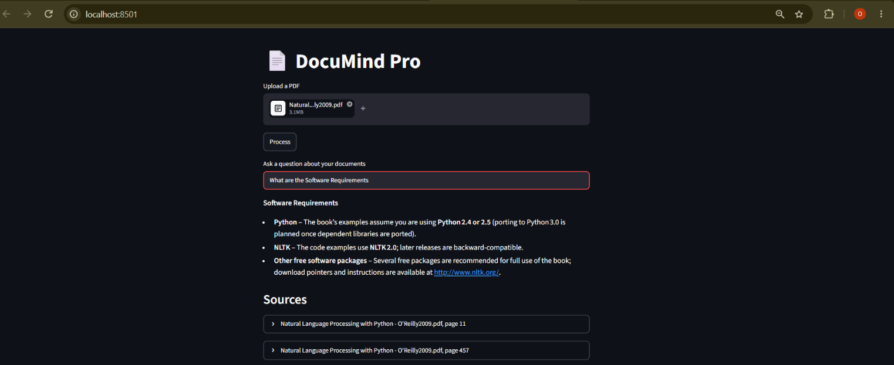
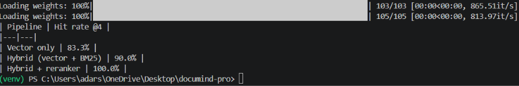

# DocuMind Pro

Chat with your PDFs. Upload any text-based PDF, ask a question in plain English, and get an answer based only on that document, with the source pages shown as proof.

DocuMind Pro is a Retrieval-Augmented Generation (RAG) app that combines **hybrid search** (vector + BM25 keyword), **cross-encoder reranking**, and an LLM served through the **Groq API**.



## Features

- Upload a PDF and index it (page-aware chunking, embeddings in ChromaDB)
- Hybrid retrieval: vector search + BM25, merged with Reciprocal Rank Fusion
- Cross-encoder reranking of the top candidates
- Answers grounded in the retrieved text; says "I couldn't find this in the documents" when the answer is missing
- Page-level source citations with the matching text
- FastAPI backend and Streamlit frontend
- LLM provider and model set through environment variables
- Retrieval evaluation script that compares three pipelines

## How it works

**Indexing (once per PDF)**

1. Extract text page by page (PyMuPDF), keeping page numbers
2. Split into chunks of 800 characters with 150 overlap
3. Embed each chunk with `all-MiniLM-L6-v2`
4. Store text, vectors, and page numbers in ChromaDB

**Answering (every question)**

1. Vector search and BM25 keyword search each return the top 10 candidates
2. Results are merged with Reciprocal Rank Fusion
3. A cross-encoder (`cross-encoder/ms-marco-MiniLM-L-6-v2`) reranks the candidates and keeps the top 4
4. The question and these chunks go to the LLM with the instruction to answer only from the context
5. The app shows the answer and the source pages

```
PDF -> chunks -> embeddings -> ChromaDB
Question -> vector search + BM25 -> fusion -> reranker -> LLM -> answer + sources
```

## Tech stack

Python, FastAPI, Streamlit, ChromaDB, sentence-transformers, rank_bm25, PyMuPDF, Groq API (OpenAI-compatible client)

## Project structure

```
documind-pro/
├── app/
│   ├── ingestion/     # PDF loading and chunking
│   ├── retrieval/     # vector store, hybrid search, reranker
│   ├── generation/    # prompt and LLM call
│   └── api/           # FastAPI routes (/upload, /ask)
├── frontend/          # Streamlit app
├── evaluation/        # test questions and evaluation script
├── tests/             # unit tests
├── data/              # local data (ignored by git)
├── .env.example
├── requirements.txt
└── README.md
```

## Setup

You need Python 3.10+ and a free Groq API key from [console.groq.com](https://console.groq.com).

```bash
git clone https://github.com/Omkar-More-12/documind-pro.git
cd documind-pro
python -m venv venv

# Windows
venv\Scripts\activate
# Mac/Linux
source venv/bin/activate

pip install -r requirements.txt
```

Create your `.env` file from the example and add your key:

```bash
# Windows
copy .env.example .env
# Mac/Linux
cp .env.example .env
```

```
LLM_PROVIDER=groq
GROQ_API_KEY=your_key_here
GROQ_MODEL=openai/gpt-oss-20b
```

Groq changes its model list from time to time. To see the models your key can use, run:

```bash
python -c "import os,requests; from dotenv import load_dotenv; load_dotenv(); r=requests.get('https://api.groq.com/openai/v1/models', headers={'Authorization':'Bearer '+os.getenv('GROQ_API_KEY')}); print('\n'.join(sorted(m['id'] for m in r.json()['data'])))"
```

## Run

Use two terminals, both from the project root with the virtual environment active.

```bash
# Terminal 1: backend (http://localhost:8000/docs)
uvicorn app.api.main:app --reload

# Terminal 2: frontend (http://localhost:8501)
streamlit run frontend/app.py
```

Open http://localhost:8501, upload a PDF, click **Process**, wait for the "Indexed ... chunks" message, then ask questions. Large PDFs can take several minutes to index on a CPU.

## Results

I tested the project in two ways: a measured retrieval evaluation on a synthetic test document, and a manual test on a real 491-page NLP book.

### 1. Retrieval evaluation (test document)

**Test document:** a synthetic 200-page university handbook that I generated for testing (not a real document). Facts such as fees, timings, and rules are placed on 30 different pages.

**Test set:** 30 questions in `evaluation/test_set.json`, each with the page where the answer is. Many questions use different wording from the document to test semantic search; others use exact terms (a Wi-Fi name, a phone number) to test keyword search.

**Metric:** hit rate @4, meaning how often the correct page appears in the top 4 retrieved chunks. The evaluation checks retrieval only and does not call the LLM.

| Pipeline | Hit rate @4 |
|---|---|
| Vector only | 83.3% |
| Hybrid (vector + BM25) | 90.0% |
| Hybrid + reranker | 100.0% |



Run it yourself:

```bash
python -m evaluation.run_eval
```

The evaluation needs the test PDF at `data/sample.pdf`. The PDF is not committed to this repository.

### 2. Manual test on a real document (NLP book)

I also tested the full app on a real document: **_Natural Language Processing with Python_ (O'Reilly, 2009), a 491-page text-based PDF** about NLP and the NLTK library. I uploaded it through the app, waited for indexing to finish, and asked questions in my own words. The book is copyrighted, so it is not included in this repository.

| Question | Expected source | Result |
|---|---|---|
| What are the software requirements? | PDF page 11 (Preface, "Software Requirements") | Answered correctly, with the source page shown |

The Preface section on that page states that the book assumes Python 2.4 or 2.5 and uses NLTK 2.0.

This test checks that the whole pipeline (indexing, hybrid retrieval, reranking, LLM answer, sources) works on a large real document. It is a manual demonstration, not a measured benchmark, so I report no accuracy number for it.

### Why two tests?

| | Real document (NLP book) | Test document (synthetic handbook) |
|---|---|---|
| Question it answers | Does the app work on a real, large PDF? | How good is the retrieval, as a number? |
| Method | Manual: upload and ask | Script: 30 questions with known answer pages |
| Output | Works / does not work | Hit rate @4 |

Accuracy needs an answer key (a known correct page for each question). Writing one for a 491-page book was not practical, so I generated a test document where the answer pages are known by construction.

## Design decisions

- **Hybrid search:** vector search handles paraphrases ("bike parking pass" matches "parking permit for two-wheelers"), while BM25 handles exact terms such as names, codes, and numbers.
- **Reranker on a short list:** a cross-encoder reads the question and chunk together, which is more accurate but slower, so it runs only on the top 10 candidates.
- **Page-aware chunks:** every chunk stores its page number so answers can cite sources.
- **Strict prompt:** the LLM must answer only from the retrieved context, which reduces made-up answers.
- **Configurable LLM:** provider and model come from environment variables, so changing models does not require code changes.
- **Free to run:** Groq's free tier and small local models mean no paid service is needed.

## Limitations

- Scanned PDFs are not supported (no OCR)
- Tables and complex layouts may be extracted poorly
- Chunks are split by character count, so a fact can be cut across chunks
- The evaluation uses a synthetic document and 30 questions. This is a small test, so a difference of one or two questions is not strong evidence
- The evaluation measures retrieval only, not the quality of the final LLM answer
- The free Groq tier has rate limits

## Future work

- Answer-quality evaluation (for example with RAGAS)
- Evaluation on real documents with more questions
- OCR support for scanned PDFs
- Docker setup and a hosted demo
- Support for multiple documents with per-document filtering

## Tests

```bash
pytest
```
